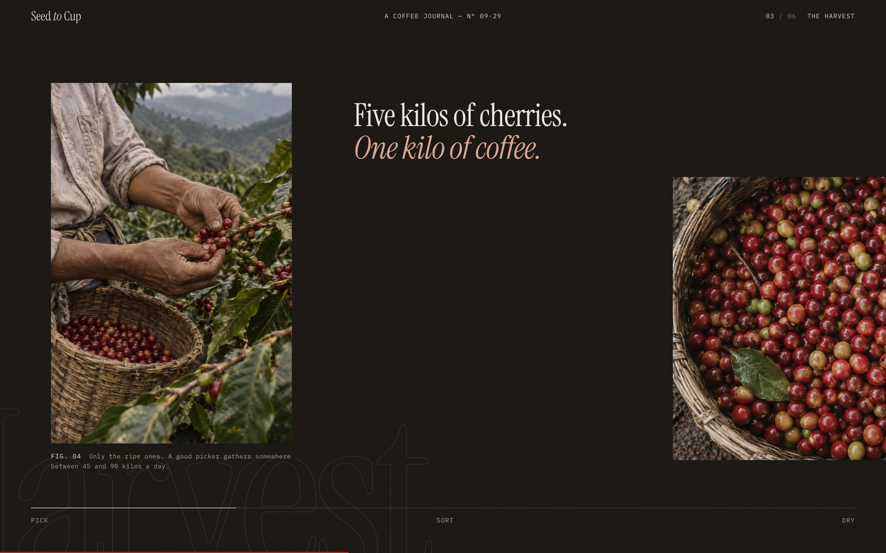
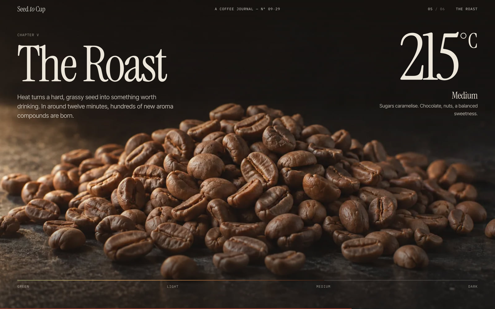
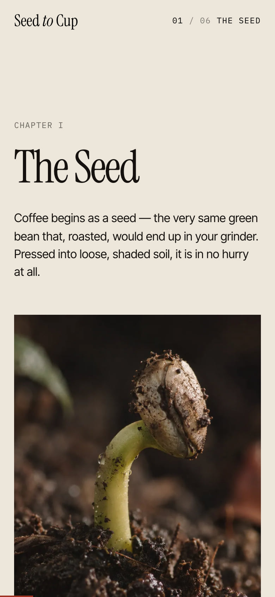

# ☕ Seed to Cup · Coffee Day

> Four years of farming, twelve minutes of roasting and three minutes of brewing, in about 24 screens of scrolling.
> Made for National Coffee Day. Also works on the other 364.

[](https://davidyen1124.github.io/coffee-day/)

**Start scrolling: <https://davidyen1124.github.io/coffee-day/>**

## What is this?

A scroll-driven coffee story, from the first seed to the final pour. Because coffee already takes months to grow, and apparently the browser needed its own elaborate journey before breakfast.

It is a single page: a prologue, six chapters and a finale. You scroll through growing, harvesting, processing, roasting and brewing, and the page moves things around to keep you interested. No beans are actually roasted by your GPU, even if the laptop fan gets ambitious.

It calls itself "A Coffee Journal — Nº 09·29". That is the date, not a count. There is one issue.

## The six chapters

| Chapter | In real life | On this page |
|---|---|---|
| **I. The Seed** | Up to a year in a nursery bag. Three or four years, all told, before the first real harvest. | A heading and two pictures, which take a second and a half each to unroll. The coffee is in no hurry either. |
| **II. The Tree** | A few days of white blossom. Then six to nine months of ripening. | A small rounded card of blossoms grows until it fills the screen. Then a colour chart tells you which cherries to pick. |
| **III. The Harvest** | Picked by hand, one cherry at a time. A good picker gathers 45 to 90 kilos a day. | You keep scrolling down. The page goes sideways. On a phone it gives up and goes down like everything else. |
| **IV. The Process** | Washed, natural or honey: three ways to get the fruit off the seed. | Three columns that drift at slightly different speeds, so you know it's a design website. |
| **V. The Roast** | Around twelve minutes. | Three screens of scrolling take a heap of beans from 20 °C to 230 °C. You are the roaster. You can also scroll back up, which real roasters would pay a lot for. |
| **VI. The Brew** | Three minutes. | An actual pour-over recipe: 15 g of coffee, 250 g of water, 94 °C. The only part of the site that produces coffee. |

| The harvest, going sideways | The roast, at medium |
|---|---|
|  |  |



Everything pictured here is a real screenshot of the site. The photographs inside the screenshots are another matter. See below.

## FAQ

**Is it National Coffee Day today?**
The cover says 29 September 2026. The date is typed straight into the HTML, so the site is correct one day a year and commemorative the rest. The footer adds that International Coffee Day is 1 October, in case you missed the first one.

**Did you visit a coffee farm for this?**
No. Nobody went anywhere. The pictures were generated with Codex CLI's image tool from the briefs in [`assets-src/art/manifest.mjs`](assets-src/art/manifest.mjs). The house style asks for images "indistinguishable from a real, unretouched photo taken on location". The location was a terminal. The site's own footer says so too.

**Are those four different piles of beans in the roast?**
One pile. The green one was generated first. The other three are edits of it, with instructions to keep "every bean's position" and "Change ONLY the roast level". That is why the crossfade lines up.

**Why is there a folder of older pictures?**
[`assets-src/art/raw/_v1/`](assets-src/art/raw/_v1) holds seven first drafts. The first roaster is a riveted antique in a dark workshop. The first honey-process coffee looks like caramel popcorn. The current briefs contain the lines "Avoid steampunk or antique machinery, copper pipes, rivets, clusters of gauges" and "not glossy, not candy-like, not caramel syrup". Draw your own conclusions.

**Is the loading percentage real?**
Up to a point, and the point is 88. The counter climbs to 88% on a timer, then waits for the fonts and the three cover layers before it finishes. Most loading bars work like this. This one has it written down in [`src/main.js`](src/main.js).

**The letter "p" in "Cup" is stuck behind a tree.**
On purpose. The cover is three layers: sky, hillside, branch. The title sits between the sky and the hillside, and the layers move at different speeds when you scroll.

**I get motion sick.**
Turn on "reduce motion" in your system settings. The page then drops the smooth scrolling and every animation and lays itself out as a plain long page. The roast stays at 20 °C and the beans stay green. It is the safest roast available.

## What's inside

- **One page.** [`index.html`](index.html) holds all the words and markup. [`src/main.js`](src/main.js) is about 340 lines of scroll effects and [`src/style.css`](src/style.css) does the rest. No framework.
- **Motion:** [GSAP](https://gsap.com/) with ScrollTrigger and SplitText. [Lenis](https://lenis.darkroom.engineering/) smooths the scrolling.
- **The sideways harvest** is a pinned track that only exists on screens wider than 760 px. The section works out its own height from the width of the track.
- **The roast** is four stacked images. Scroll position sets their opacity and the temperature readout, which runs 20, 205, 215, 230 °C.
- **The chapter counter** in the top corner is worked out from where the sections are, not from enter and leave events. Jumping around with the footer links can't confuse it.
- **Images:** 24 generated pictures, shipped as 44 WebP files (about 4.5 MB in total). The photos come in two sizes with `srcset`; the floating beans, leaf and cherries come in one. Everything below the cover is lazy-loaded.
- **Type:** Instrument Serif, Inter Tight and IBM Plex Mono, self-hosted through [Fontsource](https://fontsource.org/). The page makes no requests to anyone else's server.
- **Sharing:** the button at the end opens your device's share sheet, or copies the link if there isn't one.
- **Research:** [docs/REFERENCES.md](docs/REFERENCES.md) lists the galleries and sites that were studied, which scroll trick was borrowed from which, and the ideas that haven't been built yet.

## Where things live

```
index.html                    the page
src/                          main.js (scroll effects) and style.css
public/                       files served as-is: img/ (the WebP images), favicon.svg, og.jpg
assets-src/art/manifest.mjs   image briefs and art direction
assets-src/art/raw/           the original generated PNGs, plus _v1/ first drafts
scripts/process.mjs           turns the raw PNGs into the responsive WebP files in public/img
scripts/gen.mjs               optional: regenerates art through Codex CLI
docs/REFERENCES.md            design references and notes
docs/screenshots/             the images in this README
.github/workflows/pages.yml   the deploy
```

Nothing in `assets-src/`, `scripts/` or `docs/` is shipped to the browser.

Two things are git-ignored and stay on the author's disk: the art-generation logs (`assets-src/art/logs/`) and an older export of this same site (`archive/`). Neither is needed to run it.

## Run it locally

```sh
npm ci
npm run dev        # Vite prints the local URL
npm run build      # static site in dist/
npm run preview    # serves dist/
```

The website needs no environment variables or API key.

To rebuild the shipped images from the included originals, run this from the repo root:

```sh
node scripts/process.mjs            # everything
node scripts/process.mjs cup seed   # or just the ones you name
```

Regenerating the art itself (`node scripts/gen.mjs`) is optional and needs your own authenticated Codex CLI. The site and the image-processing script work without it.

## Deploying

Pushing to `main` runs [a GitHub Actions workflow](.github/workflows/pages.yml) that builds with Vite and publishes `dist/` to GitHub Pages. The build uses relative paths (`base: './'`), so it works under `/coffee-day/` or anywhere else.
