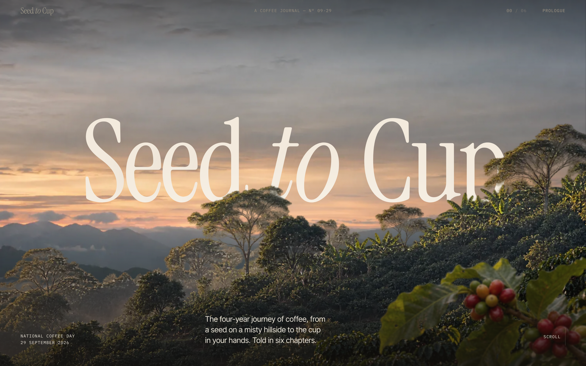
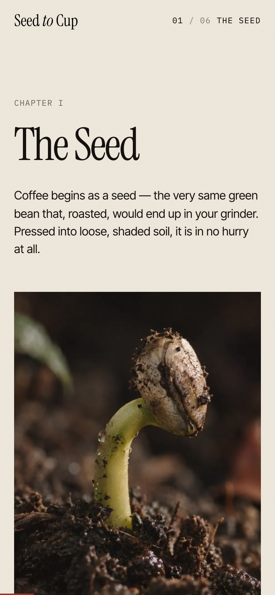

# Seed to Cup · Coffee Day

A scroll-driven coffee story, from the first seed to the final pour. Because coffee
already takes months to grow, and apparently the browser needed its own elaborate
journey before breakfast.

This is a single-page Vite site with GSAP scroll animations, Lenis smoothing,
responsive generated art, and editorial typography. Scroll through growing,
harvesting, processing, roasting and brewing. No beans are actually roasted by your
GPU, even if the laptop fan gets ambitious.



Desktop cover and the mobile Seed chapter, captured from the running website at 2× pixel density.



## Run locally

```sh
npm ci
npm run dev
```

Open the local URL Vite prints. The website needs no environment variables or API key.

```sh
npm run build
npm run preview
```

The production output goes to `dist/`. `vercel.json` records the deployment setup.

## Where things live

- `index.html`, `src/main.js`, `src/style.css`: page, animation and styling.
- `public/`: the optimized images, favicon and social preview used by the site.
- `art/manifest.mjs`: image briefs and visual direction.
- `art/raw/`: original generated PNGs, including earlier variants, for future edits.
- `scripts/process.mjs`: converts raw art to responsive WebP assets.
- `scripts/gen.mjs`: optional art regeneration through an authenticated Codex CLI.
- `REFERENCES.md`: design references and notes from the original research.

To rebuild the shipped images from the included originals:

```sh
node scripts/process.mjs
```

Art regeneration is optional and requires your own Codex CLI setup. The checked-in
website and image-processing workflow do not need it.

## What this backup contains

Current source, shipped images, original art, the image briefs and scripts, references,
deployment configuration, and the dependency lockfile are included. Dependencies,
build output, Vercel's local project link, art-generation logs and local secrets stay
local. `archive/v1-papercut.tar.gz` is an older export of this same website and is also
kept local; it is not needed to run the current version.
